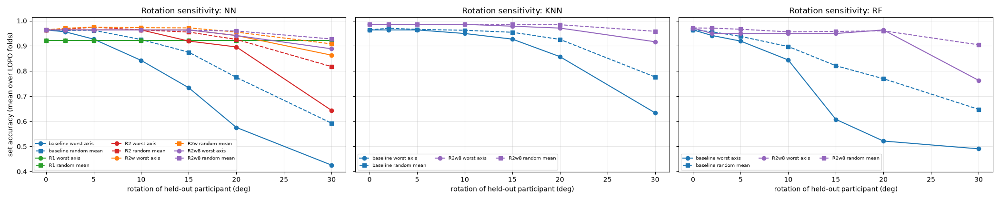

# Phase 1: rotation sensitivity (S2a)

> Generated by `python -m workout_ml.analysis.rotation_sensitivity`; do not edit.
> Code ab11d391 (dirty=False), data md5 45732a83275a4045dd1b7b5a8c229a14.dir, computed this invocation: KNN/baseline, KNN/R2w8, RF/baseline, RF/R2w8 (515 s); other (model, variant) pairs reused from the cached per-fold results of the same protocol, seeds and data.

The held-out participant's acc and gyro columns are rotated by the same R before feature engineering. Models are trained on unrotated data, except the augmented variants. The model is a parameter (NN, KNN, RF; hyper-parameters as in the main pipeline); every (model, variant) pair uses the same seeds, rotation conditions and tolerance definition. Augmentation method: the training set is the original (unrotated) training sets PLUS K rotated copies of them (not K copies only); each copy of each set gets its own random R (uniform random axis, angle uniform in [0, max]), applied to acc and gyro before feature engineering; same seed for every augmented variant. R2: K=4, max 15 deg; R2w: K=4, max 30 deg; R2w8: K=8, max 30 deg. Metrics are means over the 5 LOPO folds. 'Worst axis' = the signed axis (+-x, +-y, +-z) with the lowest set accuracy at that theta; 'rand' = mean over 10 seeded random axes. 'Kabsch' is the equivalent gravity residual 2 sin(theta/2) in g. 'conf' is the pooled bench->OHP + OHP->bench window rate over bench and OHP windows.

## theta_tol (section 7.3 definition)

Largest theta where, over the worst axis, set accuracy drops <= 2 pp and bench and OHP recall each drop <= 5 pp vs theta = 0. 'signed' considers the six signed axes; 'all' also includes the random axes.

| model | variant | theta_tol (signed axes) | theta_tol (all axes) |
|---|---|---|---|
| NN | baseline | 2 | 2 |
| NN | R1 | 30 | 30 |
| NN | R2 | 5 | 5 |
| NN | R2w | 10 | 10 |
| NN | R2w8 | 10 | 10 |
| KNN | baseline | 5 | 5 |
| KNN | R2w8 | 15 | 15 |
| RF | baseline | 0 | 0 |
| RF | R2w8 | 0 | 0 |

## Metrics at theta = 0

| model | variant | set acc | window macro-F1 | bench recall | OHP recall | conf |
|---|---|---|---|---|---|---|
| NN | baseline | 0.963 | 0.957 | 0.858 | 0.976 | 0.052 |
| NN | R1 | 0.921 | 0.848 | 0.846 | 0.838 | 0.057 |
| NN | R2 | 0.963 | 0.941 | 0.844 | 0.948 | 0.061 |
| NN | R2w | 0.963 | 0.952 | 0.845 | 0.970 | 0.061 |
| NN | R2w8 | 0.963 | 0.952 | 0.850 | 0.982 | 0.057 |
| KNN | baseline | 0.963 | 0.954 | 0.888 | 0.959 | 0.064 |
| KNN | R2w8 | 0.986 | 0.959 | 0.890 | 0.972 | 0.055 |
| RF | baseline | 0.963 | 0.922 | 0.860 | 0.928 | 0.094 |
| RF | R2w8 | 0.971 | 0.956 | 0.840 | 0.988 | 0.057 |

## NN / baseline

| theta | Kabsch (g) | worst axis | set acc | bench | OHP | conf | min bench (signed) | min OHP (signed) | rand set acc | rand bench | rand OHP | rand conf |
|---|---|---|---|---|---|---|---|---|---|---|---|---|
| 0 | 0.000 | none | 0.963 | 0.858 | 0.976 | 0.052 | 0.858 | 0.976 | 0.963 | 0.858 | 0.976 | 0.052 |
| 2 | 0.035 | -z | 0.956 | 0.870 | 0.932 | 0.070 | 0.821 | 0.932 | 0.961 | 0.857 | 0.966 | 0.057 |
| 5 | 0.087 | -z | 0.927 | 0.899 | 0.803 | 0.142 | 0.718 | 0.803 | 0.962 | 0.850 | 0.941 | 0.078 |
| 10 | 0.174 | +z | 0.842 | 0.442 | 1.000 | 0.218 | 0.442 | 0.391 | 0.925 | 0.745 | 0.937 | 0.126 |
| 15 | 0.261 | +z | 0.733 | 0.076 | 1.000 | 0.453 | 0.076 | 0.204 | 0.875 | 0.742 | 0.757 | 0.187 |
| 20 | 0.347 | -z | 0.575 | 0.926 | 0.092 | 0.383 | 0.010 | 0.092 | 0.775 | 0.710 | 0.660 | 0.246 |
| 30 | 0.518 | -z | 0.426 | 0.924 | 0.014 | 0.435 | 0.000 | 0.014 | 0.592 | 0.543 | 0.526 | 0.286 |

## NN / R1

| theta | Kabsch (g) | worst axis | set acc | bench | OHP | conf | min bench (signed) | min OHP (signed) | rand set acc | rand bench | rand OHP | rand conf |
|---|---|---|---|---|---|---|---|---|---|---|---|---|
| 0 | 0.000 | none | 0.921 | 0.846 | 0.838 | 0.057 | 0.846 | 0.838 | 0.921 | 0.846 | 0.838 | 0.057 |
| 2 | 0.035 | +x | 0.921 | 0.846 | 0.838 | 0.057 | 0.846 | 0.838 | 0.921 | 0.846 | 0.838 | 0.057 |
| 5 | 0.087 | +x | 0.921 | 0.846 | 0.838 | 0.057 | 0.846 | 0.838 | 0.921 | 0.846 | 0.838 | 0.057 |
| 10 | 0.174 | +x | 0.921 | 0.846 | 0.838 | 0.057 | 0.846 | 0.838 | 0.921 | 0.846 | 0.838 | 0.057 |
| 15 | 0.261 | +x | 0.921 | 0.846 | 0.838 | 0.057 | 0.846 | 0.838 | 0.921 | 0.846 | 0.838 | 0.057 |
| 20 | 0.347 | +x | 0.921 | 0.846 | 0.838 | 0.057 | 0.846 | 0.838 | 0.921 | 0.846 | 0.838 | 0.057 |
| 30 | 0.518 | +x | 0.921 | 0.846 | 0.838 | 0.057 | 0.846 | 0.838 | 0.921 | 0.846 | 0.838 | 0.057 |

## NN / R2

| theta | Kabsch (g) | worst axis | set acc | bench | OHP | conf | min bench (signed) | min OHP (signed) | rand set acc | rand bench | rand OHP | rand conf |
|---|---|---|---|---|---|---|---|---|---|---|---|---|
| 0 | 0.000 | none | 0.963 | 0.844 | 0.948 | 0.061 | 0.844 | 0.948 | 0.963 | 0.844 | 0.948 | 0.061 |
| 2 | 0.035 | +x | 0.963 | 0.842 | 0.944 | 0.061 | 0.840 | 0.942 | 0.966 | 0.844 | 0.950 | 0.061 |
| 5 | 0.087 | -x | 0.963 | 0.843 | 0.967 | 0.062 | 0.839 | 0.925 | 0.975 | 0.845 | 0.955 | 0.061 |
| 10 | 0.174 | -x | 0.963 | 0.846 | 0.972 | 0.060 | 0.835 | 0.876 | 0.963 | 0.841 | 0.962 | 0.061 |
| 15 | 0.261 | -y | 0.919 | 0.869 | 0.915 | 0.058 | 0.826 | 0.766 | 0.955 | 0.846 | 0.893 | 0.082 |
| 20 | 0.347 | +x | 0.896 | 0.831 | 0.679 | 0.125 | 0.822 | 0.679 | 0.926 | 0.852 | 0.854 | 0.093 |
| 30 | 0.518 | +x | 0.643 | 0.310 | 0.531 | 0.094 | 0.310 | 0.531 | 0.818 | 0.725 | 0.725 | 0.104 |

## NN / R2w

| theta | Kabsch (g) | worst axis | set acc | bench | OHP | conf | min bench (signed) | min OHP (signed) | rand set acc | rand bench | rand OHP | rand conf |
|---|---|---|---|---|---|---|---|---|---|---|---|---|
| 0 | 0.000 | none | 0.963 | 0.845 | 0.970 | 0.061 | 0.845 | 0.970 | 0.963 | 0.845 | 0.970 | 0.061 |
| 2 | 0.035 | +x | 0.963 | 0.845 | 0.970 | 0.061 | 0.844 | 0.969 | 0.970 | 0.846 | 0.971 | 0.060 |
| 5 | 0.087 | +x | 0.963 | 0.847 | 0.968 | 0.062 | 0.841 | 0.967 | 0.975 | 0.848 | 0.971 | 0.060 |
| 10 | 0.174 | +y | 0.963 | 0.845 | 0.976 | 0.060 | 0.841 | 0.951 | 0.972 | 0.846 | 0.975 | 0.060 |
| 15 | 0.261 | +x | 0.963 | 0.845 | 0.906 | 0.090 | 0.838 | 0.906 | 0.972 | 0.849 | 0.950 | 0.071 |
| 20 | 0.347 | +x | 0.941 | 0.841 | 0.847 | 0.119 | 0.836 | 0.847 | 0.955 | 0.855 | 0.927 | 0.082 |
| 30 | 0.518 | +x | 0.863 | 0.723 | 0.704 | 0.138 | 0.723 | 0.704 | 0.908 | 0.822 | 0.847 | 0.100 |

## NN / R2w8

| theta | Kabsch (g) | worst axis | set acc | bench | OHP | conf | min bench (signed) | min OHP (signed) | rand set acc | rand bench | rand OHP | rand conf |
|---|---|---|---|---|---|---|---|---|---|---|---|---|
| 0 | 0.000 | none | 0.963 | 0.850 | 0.982 | 0.057 | 0.850 | 0.982 | 0.963 | 0.850 | 0.982 | 0.057 |
| 2 | 0.035 | +x | 0.963 | 0.851 | 0.981 | 0.058 | 0.849 | 0.980 | 0.963 | 0.851 | 0.982 | 0.057 |
| 5 | 0.087 | +x | 0.963 | 0.851 | 0.979 | 0.060 | 0.846 | 0.978 | 0.963 | 0.851 | 0.980 | 0.057 |
| 10 | 0.174 | +x | 0.963 | 0.845 | 0.962 | 0.066 | 0.844 | 0.962 | 0.963 | 0.848 | 0.979 | 0.059 |
| 15 | 0.261 | +x | 0.963 | 0.838 | 0.929 | 0.079 | 0.838 | 0.929 | 0.962 | 0.845 | 0.967 | 0.065 |
| 20 | 0.347 | +z | 0.941 | 0.841 | 0.953 | 0.079 | 0.819 | 0.887 | 0.959 | 0.850 | 0.951 | 0.069 |
| 30 | 0.518 | +x | 0.888 | 0.718 | 0.761 | 0.096 | 0.718 | 0.761 | 0.928 | 0.824 | 0.884 | 0.074 |

## KNN / baseline

| theta | Kabsch (g) | worst axis | set acc | bench | OHP | conf | min bench (signed) | min OHP (signed) | rand set acc | rand bench | rand OHP | rand conf |
|---|---|---|---|---|---|---|---|---|---|---|---|---|
| 0 | 0.000 | none | 0.963 | 0.888 | 0.959 | 0.064 | 0.888 | 0.959 | 0.963 | 0.888 | 0.959 | 0.064 |
| 2 | 0.035 | -x | 0.963 | 0.891 | 0.957 | 0.065 | 0.874 | 0.951 | 0.970 | 0.889 | 0.958 | 0.065 |
| 5 | 0.087 | -x | 0.963 | 0.893 | 0.954 | 0.066 | 0.844 | 0.929 | 0.966 | 0.891 | 0.954 | 0.067 |
| 10 | 0.174 | +z | 0.949 | 0.757 | 0.983 | 0.082 | 0.757 | 0.867 | 0.962 | 0.852 | 0.962 | 0.070 |
| 15 | 0.261 | +z | 0.927 | 0.653 | 0.991 | 0.124 | 0.653 | 0.760 | 0.954 | 0.858 | 0.940 | 0.085 |
| 20 | 0.347 | +x | 0.857 | 0.821 | 0.901 | 0.108 | 0.453 | 0.635 | 0.926 | 0.855 | 0.873 | 0.128 |
| 30 | 0.518 | +x | 0.634 | 0.246 | 0.733 | 0.099 | 0.217 | 0.422 | 0.776 | 0.657 | 0.737 | 0.181 |

## KNN / R2w8

| theta | Kabsch (g) | worst axis | set acc | bench | OHP | conf | min bench (signed) | min OHP (signed) | rand set acc | rand bench | rand OHP | rand conf |
|---|---|---|---|---|---|---|---|---|---|---|---|---|
| 0 | 0.000 | none | 0.986 | 0.890 | 0.972 | 0.055 | 0.890 | 0.972 | 0.986 | 0.890 | 0.972 | 0.055 |
| 2 | 0.035 | +x | 0.986 | 0.889 | 0.972 | 0.055 | 0.881 | 0.969 | 0.986 | 0.888 | 0.970 | 0.057 |
| 5 | 0.087 | +x | 0.986 | 0.895 | 0.965 | 0.059 | 0.879 | 0.963 | 0.986 | 0.890 | 0.969 | 0.056 |
| 10 | 0.174 | +x | 0.986 | 0.892 | 0.951 | 0.072 | 0.875 | 0.946 | 0.986 | 0.880 | 0.971 | 0.058 |
| 15 | 0.261 | +x | 0.978 | 0.885 | 0.932 | 0.089 | 0.878 | 0.932 | 0.986 | 0.887 | 0.960 | 0.065 |
| 20 | 0.347 | +x | 0.971 | 0.874 | 0.906 | 0.112 | 0.874 | 0.906 | 0.984 | 0.891 | 0.951 | 0.068 |
| 30 | 0.518 | +x | 0.916 | 0.829 | 0.792 | 0.189 | 0.829 | 0.792 | 0.958 | 0.879 | 0.892 | 0.108 |

## RF / baseline

| theta | Kabsch (g) | worst axis | set acc | bench | OHP | conf | min bench (signed) | min OHP (signed) | rand set acc | rand bench | rand OHP | rand conf |
|---|---|---|---|---|---|---|---|---|---|---|---|---|
| 0 | 0.000 | none | 0.963 | 0.860 | 0.928 | 0.094 | 0.860 | 0.928 | 0.963 | 0.860 | 0.928 | 0.094 |
| 2 | 0.035 | +y | 0.941 | 0.855 | 0.940 | 0.084 | 0.835 | 0.890 | 0.956 | 0.861 | 0.920 | 0.098 |
| 5 | 0.087 | -y | 0.919 | 0.869 | 0.882 | 0.124 | 0.778 | 0.785 | 0.938 | 0.849 | 0.901 | 0.120 |
| 10 | 0.174 | +z | 0.844 | 0.492 | 0.952 | 0.253 | 0.492 | 0.500 | 0.897 | 0.743 | 0.902 | 0.156 |
| 15 | 0.261 | +z | 0.608 | 0.213 | 0.949 | 0.442 | 0.213 | 0.419 | 0.821 | 0.732 | 0.720 | 0.221 |
| 20 | 0.347 | +z | 0.521 | 0.191 | 0.940 | 0.456 | 0.191 | 0.360 | 0.769 | 0.718 | 0.689 | 0.258 |
| 30 | 0.518 | +z | 0.490 | 0.216 | 0.819 | 0.444 | 0.165 | 0.250 | 0.648 | 0.556 | 0.579 | 0.253 |

## RF / R2w8

| theta | Kabsch (g) | worst axis | set acc | bench | OHP | conf | min bench (signed) | min OHP (signed) | rand set acc | rand bench | rand OHP | rand conf |
|---|---|---|---|---|---|---|---|---|---|---|---|---|
| 0 | 0.000 | none | 0.971 | 0.840 | 0.988 | 0.057 | 0.840 | 0.988 | 0.971 | 0.840 | 0.988 | 0.057 |
| 2 | 0.035 | +y | 0.949 | 0.836 | 0.988 | 0.059 | 0.836 | 0.987 | 0.971 | 0.841 | 0.989 | 0.057 |
| 5 | 0.087 | -x | 0.949 | 0.838 | 0.989 | 0.058 | 0.834 | 0.985 | 0.966 | 0.840 | 0.989 | 0.057 |
| 10 | 0.174 | -x | 0.949 | 0.838 | 0.990 | 0.057 | 0.825 | 0.983 | 0.956 | 0.835 | 0.989 | 0.058 |
| 15 | 0.261 | +y | 0.949 | 0.822 | 0.988 | 0.064 | 0.822 | 0.961 | 0.957 | 0.833 | 0.982 | 0.063 |
| 20 | 0.347 | -x | 0.963 | 0.837 | 0.989 | 0.058 | 0.818 | 0.909 | 0.960 | 0.834 | 0.970 | 0.070 |
| 30 | 0.518 | +x | 0.763 | 0.643 | 0.525 | 0.191 | 0.643 | 0.525 | 0.904 | 0.800 | 0.877 | 0.087 |

